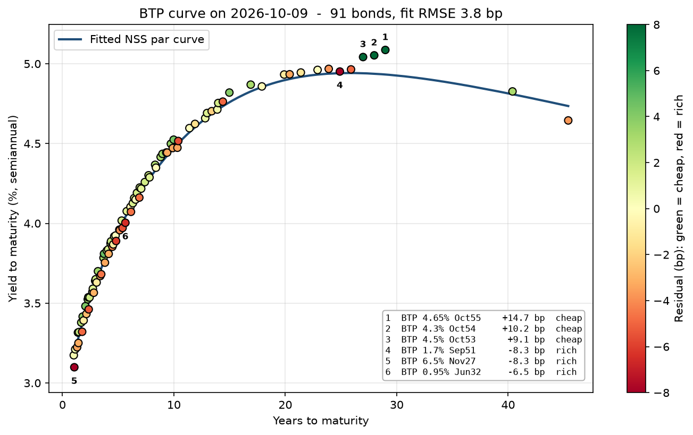
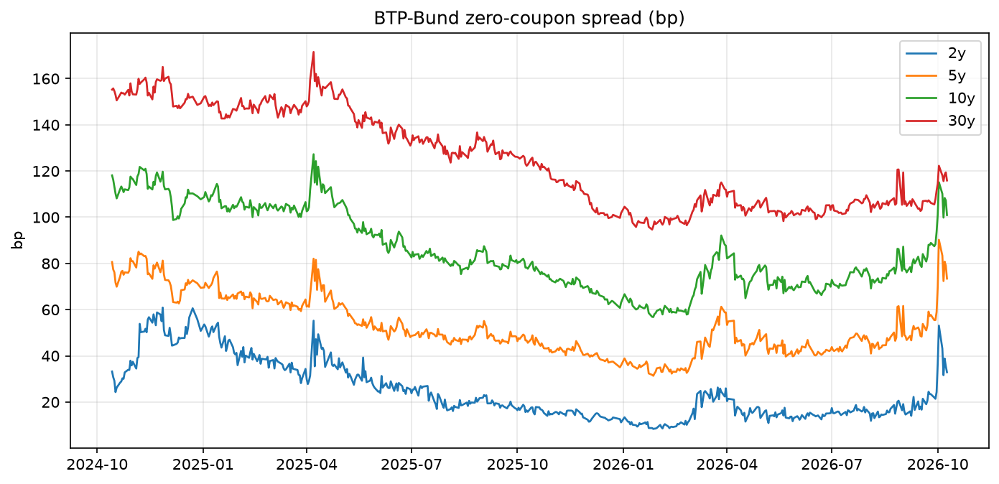
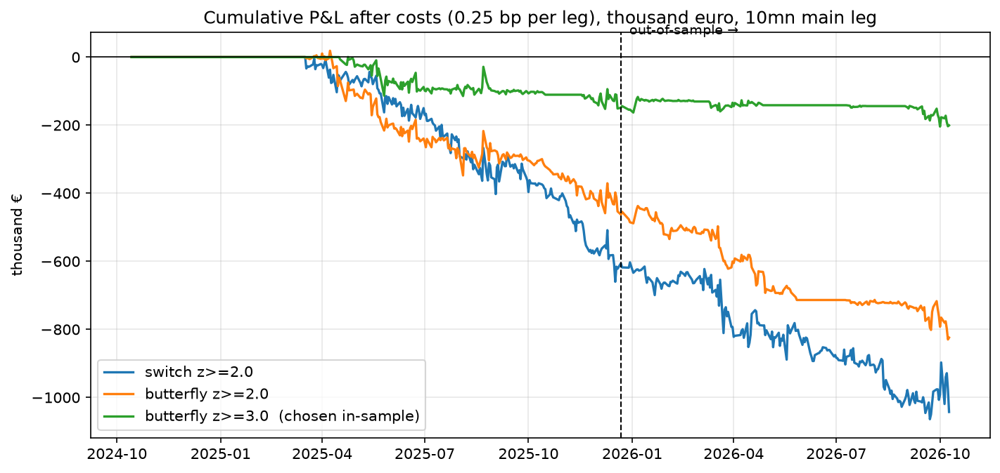
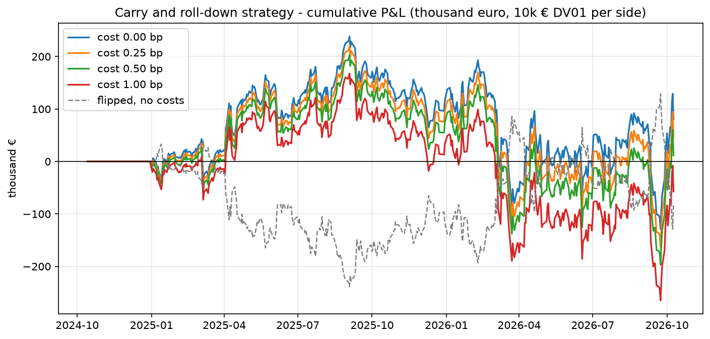
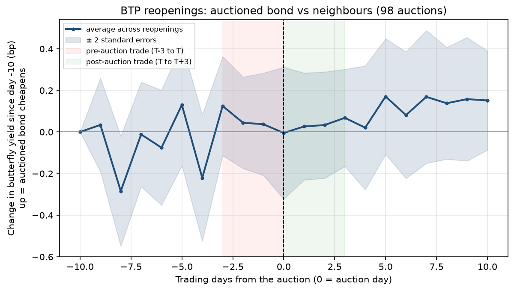

# BTP Spread Lab

**Relative value research on the Italian government bond curve, built from public data, with an honest backtest.**

91 fixed-rate BTPs · two years of daily prices (Oct 2024 – Oct 2026) · QuantLib pricing validated against Borsa Italiana · Nelson-Siegel-Svensson curve · four trading strategies tested with transaction costs, out-of-sample checks and placebo tests · 103 automated tests.

---

## TL;DR – what I found

| Strategy | Is there a signal? | After costs | Why |
|---|---|---|---|
| Rich/cheap **switches** (DV01-neutral pairs) | **Yes**: +0.25 bp per trade, mirrored exactly by the flipped strategy | Loses (−0.71 bp per trade) | The signal is mostly a **one-day reversal of noisy daily prices**: worth +2.14 bp if you could trade at the signal price, +0.25 bp trading the next day, less than the 1 bp round-trip cost |
| Rich/cheap **butterflies** | No (0.00 bp) | Loses | Curve risk is fully hedged (curve P&L +0.01 bp), but the timing problem remains |
| **Carry and roll-down** (monthly) | Weak (Sharpe 0.17 gross) | ≈ 0 (Sharpe 0.10) | In practice it is a **curve steepener** (long 4.5y, short 18.9y on average): P&L is driven by curve shape, not by carry |
| **Auction cycle** (98 BTP reopenings) | No (t-stat −0.9) | Loses | No measurable cheapening of the auctioned bond relative to its neighbours |

**No strategy makes money reliably after costs.** BTP relative value anomalies exist, but with daily closing prices they are either smaller than transaction costs or too fast to capture. Exploiting them would require executable intraday prices (e.g. MTS) and market-maker costs – which is exactly what a trading desk has.

The value of the project is the framework: every number below is reproducible, validated and tested, and the backtest is built to avoid fooling myself.

---

## 1. Data – public sources only

| Data | Source | How |
|---|---|---|
| Universe of BTPs (ISIN, coupon, dates, outstanding) | Banca d'Italia, *Titoli di Stato in circolazione* | monthly file, `data/anagrafica.py` |
| Daily prices (VWAP, volumes) | Euronext / Borsa Italiana MOT, historical files | downloaded by hand per ISIN, **kept local, not redistributed** (terms of use) |
| €STR | ECB Data Portal API | `data/riferimento.py` |
| Bund zero-coupon curve | Deutsche Bundesbank API | `data/riferimento.py` |
| Auction results | Banca d'Italia, *Risultati aste dei titoli di Stato* | `data/aste.py` |

Everything goes into one SQLite database (`data/btp.db`) and the whole pipeline runs with `python data/update.py`. Data-quality checks flag missing days, price outliers and VWAP errors (e.g. a VWAP outside the day's low–high range is replaced by the close).

## 2. Pricing engine – validated

`pricing/bond_math.py` prices every BTP with BTP conventions: semiannual coupons, ACT/ACT ICMA, T+2 settlement on the TARGET calendar, short first coupons.

- Accrued interest and yield are implemented **twice**: by hand (formulas + bisection) and with **QuantLib**. They agree to the 13th decimal on every observation.
- **Validation against Borsa Italiana** (BTP 3.85% Feb-2035, reference price 96.23 on 12 Oct 2026):

| | Borsa Italiana | BTP Spread Lab |
|---|---|---|
| Accrued interest | 0.77418 | 0.774185 |
| Gross yield (annual compounding) | 4.44 | 4.4447 |
| Modified duration | 6.8 | 6.798 (annual) / 6.947 (semiannual) |

The duration difference is a convention, not an error: modified duration = Macaulay / (1 + y/k) depends on the compounding frequency k of the yield. Macaulay is 7.10 in both cases.

## 3. The curve – Nelson-Siegel-Svensson

`curve/fit_curve.py` fits an NSS zero-coupon curve to all BTPs every day:
- errors measured in **bp of yield** (price errors divided by each bond's price value of 1 bp), so a 30-year bond does not dominate the fit;
- **robust loss** (soft-L1, 5 bp scale), so structurally rich or cheap bonds do not bend the curve;
- warm start from the previous day's curve for stable parameters.

Fit quality: **RMSE 3.8 bp** on 91 bonds (9 Oct 2026). On synthetic data the fit recovers the true curve within 0.3 bp.

**Residual = market yield − model yield.** Positive = cheap, negative = rich.



A clear **coupon effect**: low-coupon bonds issued in 2020–21 (0.6%, 0.95%, 1.7%) trade rich; recent high-coupon long bonds (4.3%–4.65%, 2053–55) trade cheap. A residual is therefore *not* a trading signal by itself – part of it is structural.

**BTP–Bund spread.** I checked that the Bundesbank publishes NSS zero-coupon rates with continuous compounding by re-computing its published rates from its published parameters (18 out of 18 points match). Our BTP curve uses the same model and convention, so the zero-coupon spread is like-for-like. A model-free check (average of real BTPs in the 1.5–2.5 year bucket vs Bund 2y) moves with the curve-based spread with a **0.96 correlation** of daily changes.



## 4. From residuals to signals

- **z-score** of each residual against its own last 60 trading days (no look-ahead).
- **Mean reversion** measured by the half-life of an AR(1) model.

A key finding: on daily data the median half-life is **1.7 days**; on weekly averages it is **23 days**. A simulation (true half-life 10 days + price noise) reproduces exactly this pattern: daily estimates ≈ 1.3 days, weekly ≈ 9. The daily residual is dominated by **price noise** (VWAPs of thinly traded bonds), and signals are therefore built on 5-day smoothed residuals and weekly half-lives.

Also computed for every bond and day: **one-month carry and roll-down** (financing at €STR) and DV01-neutral **switch candidates**.

## 5. Backtests – built not to cheat

Common rules for all strategies:
1. signals use only past data (rolling windows; half-lives re-estimated monthly on the past year);
2. a signal at the close of day *t* is **executed at the price of day t+1**;
3. bid-ask costs on every leg, entry and exit (base case 0.25 bp per unit of DV01, i.e. 1 bp per switch round trip), with sensitivity from 0 to 1 bp;
4. **placebo**: the flipped strategy must lose what the strategy gains;
5. **first half vs second half** of the sample, and parameter choice **in-sample only**, evaluated out-of-sample.

### 5.1 Rich/cheap switches and butterflies

| Before costs, avg per trade | total | residual | curve | carry |
|---|---|---|---|---|
| Switches, trade next day | +0.25 bp | +0.39 | −0.16 | +0.01 |
| Switches, same day (*not tradable*) | +2.14 bp | +2.27 | −0.13 | 0.00 |
| Butterflies, trade next day | 0.00 bp | 0.00 | +0.01 | 0.00 |
| Butterflies, same day (*not tradable*) | +1.56 bp | +1.57 | 0.00 | 0.00 |

308 switch trades, 56.5% hit rate before costs; the flipped strategy loses −0.25 bp per trade – the signal is real. After 0.25 bp per leg: −0.71 bp per trade. Choosing among six configurations on the first half only selects butterflies with z ≥ 3, which already lose in-sample (Sharpe −0.92) and lose out-of-sample (−0.59).



### 5.2 Carry and roll-down

Rules fixed in advance: each month rank BTPs by (carry + roll-down) / yield volatility, long the top third, short the bottom third, DV01-neutral (10,000 € per bp per side).

| | P&L per year | Sharpe |
|---|---|---|
| no costs | +45,069 € | 0.17 |
| 0.25 bp | +25,732 € | 0.10 |
| flipped, no costs | −45,069 € | −0.17 |
| first half / second half | +132,514 € / −82,004 € | 0.68 / −0.26 |

Positive but not distinguishable from zero, with a max drawdown much larger than the annual gain. The portfolio is long the short end (4.5 years on average) and short the long end (18.9 years): ranking by carry is, in practice, a **steepener**.



### 5.3 Auction cycle

Hypothesis from the literature (Lou, Yan & Zhang, 2013; Beetsma et al., 2016): reopened bonds cheapen before auctions and recover after. Test: butterfly of the auctioned bond against its nearest neighbours (level- and slope-neutral), short from T−3 to T, long from T to T+3, on **98 reopenings**.

| | mean | t-stat |
|---|---|---|
| pre-auction, gross | −0.13 bp | −0.87 |
| post-auction, gross | −0.07 bp | −0.55 |

No effect. A plausible reason: the documented auction concession is in the *level* of Italian yields (the whole curve cheapens); relative to its neighbours, the auctioned bond does not move.



## 6. What I learned

- A model that fits the curve well (3.8 bp) does not make its residuals tradable: residual = opportunity + structure + noise.
- **Execution timing** matters more than the model: the same signal is worth 2.14 bp at the signal price and 0.25 bp a day later.
- Hedging curve risk (butterflies) works exactly as designed – and shows that curve risk was not the main problem.
- "Carry" strategies hide factor bets; always check what the portfolio actually holds.
- Testing many ideas guarantees that one looks good by chance. Rules were fixed before each test and parameter choices were made in-sample only.

## 7. Limitations

- Prices are daily VWAPs from the retail market (MOT), not executable interdealer quotes (MTS).
- The universe is the BTPs outstanding today: bonds that matured during 2024–26 are missing from the early part of the curve.
- Repo is proxied by €STR; bonds trading special in repo are not modelled.
- Two years of data: enough for daily signals, short for a monthly strategy.

## 8. How to run

```bash
python -m venv .venv && source .venv/bin/activate
pip install pandas xlrd openpyxl requests QuantLib scipy matplotlib pytest
# put the Euronext price files in data/raw/euronext/ and the Bank of Italy files in data/raw/ and data/raw/aste/
python data/update.py                 # data, pricing, curve, signals, carry, switches
python -m curve.plot_curve            # charts
python -m backtest.run_backtest       # switch backtest
python -m backtest.research           # diagnosis, butterflies, in/out-of-sample selection
python -m backtest.carry_strategy
python -m backtest.auction_strategy
pytest                                # 103 tests
```

## 9. Project structure

```
data/       sources, cleaning, data-quality checks, SQLite database, one-command pipeline
pricing/    bond math (by hand and QuantLib), analytics for every bond and day
curve/      Nelson-Siegel-Svensson fit, residuals, BTP-Bund spread, charts
signals/    z-scores, half-lives, carry and roll-down, switch screener, model-free checks
backtest/   backtest engine (switches, butterflies), research, carry and auction strategies
tests/      103 automated tests
```

---

*Alberto Zannella – MSc Economics and Finance, University of Bergamo. Research project for educational purposes; not investment advice.*
